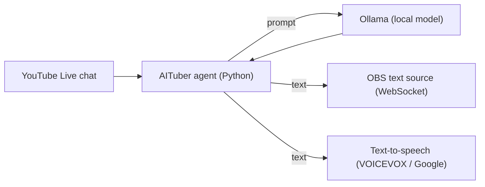

# AITuber Agent

[English](README.md) | 日本語

> 趣味のプロジェクト。名称は作業名です。

**一言でいうと:** 配信向けの AI コホストです。YouTube Live のチャットを読み、ローカル言語モデルで返信を書き、OBS 経由で画面に表示し、音声合成で読み上げます。

## できること
- YouTube Live のチャットからコメントを読み取ります。
- 配信者自身のマシンで [Ollama](https://ollama.com) が提供するモデルで返信を生成します。そのため、視聴者のコメントはクラウドの AI サービスに送られません。
- 返信を OBS のテキストソース（OBS WebSocket 経由）に送り、音声合成エンジン（VOICEVOX または Google Cloud Text-to-Speech）で読み上げます。
- オフラインのデモでは、固定のコメントを使い、外部サービスを一切使わずに、コメントから返信、表示までの同じ経路を実行します。

## 作り方

## 状態
| 確認済み | 方法 |
|---|---|
| コメントから返信、表示までの経路 | オフラインデモ（`demo.py`）を 2026-10-12 に固定コメントで実行しました |
| 未確認 | |
| 実際の YouTube Live 配信、OBS、TTS の組み合わせ | APIキー、配信、OBS が必要です。通しでは実行していません |
| 返信の質とモデレーション | 評価していません |

## 展望
いちばん役に立つ役割は、完全な AI 配信者というより、**人間の VTuber と組む AI パートナー**だろうと考えています。チャットに追いつき、常連の質問に答え、沈黙の隙間を埋める共演者であり、主役は人間のままです。モデルが進化すれば、配信者が何も変えなくてもパートナーは良くなります。

*ソースは非公開で、希望に応じて共有できます。[Happy AI Garage](https://github.com/johnknash2025) の趣味のプロジェクトです。*
