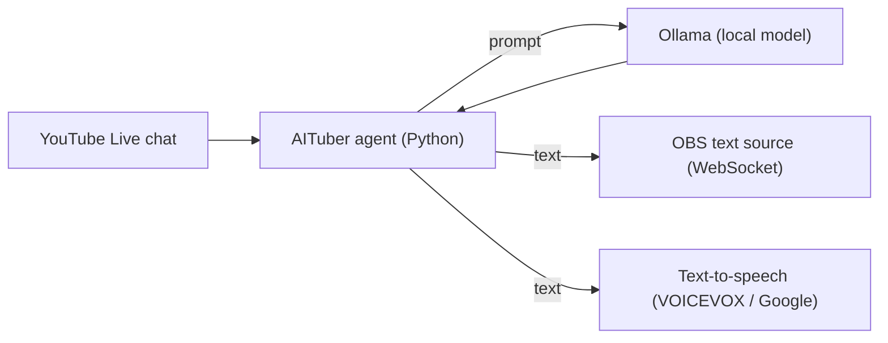

# AITuber Agent

[English](README.md) | 日本語

> hobby 開発。名称は作業名です。

**一言でいうと:** 配信に同行する AI です。YouTube Live のチャットを読み、ローカル言語モデルで返信を書き、OBS 経由で画面に出し、音声合成で読み上げます。

## できること
- YouTube Live のコメントを読み取ります。
- 配信者自身のマシンで [Ollama](https://ollama.com) が提供するモデルで返信を生成するため、視聴者のコメントがクラウドの AI サービスに送られることはありません。
- 返信を OBS のテキストソース（OBS WebSocket 経由）に送るか、音声合成エンジン（VOICEVOX または Google Cloud Text-to-Speech）で読み上げます。
- オフラインのデモでは、固定のコメントを使い外部サービスを一切使わずに、コメントから返信、表示までの同じ経路を実行します。

## 作り方

## 状態
| 確認済み | 方法 |
|---|---|
| コメントから返信、表示までの経路 | オフラインデモ（`demo.py`）を 2026-10-12 に固定コメントで実行 |
| 未確認 | |
| 実際の YouTube Live 配信、OBS、TTS の組み合わせ | APIキー・配信・OBS が必要。通しでは未実行 |
| 返信の質とモデレーション | 評価していません |

## 展望
いちばん役に立ちそうなのは、完全な AI 配信者ではなく、**人間と組む VTuber の AI パートナー**という立ち位置だと考えています。チャットに追従し、常連の会話に応じ、沈黙の隙間埋める共演者で、主役は人間のままです。モデルが進化するほど、配信者が何も変更しなくてもパートナーは上達します。

*ソースは非公開で、希望があれば共有できます。[Happy AI Garage](https://github.com/johnknash2025) の hobby プロジェクトです。*
