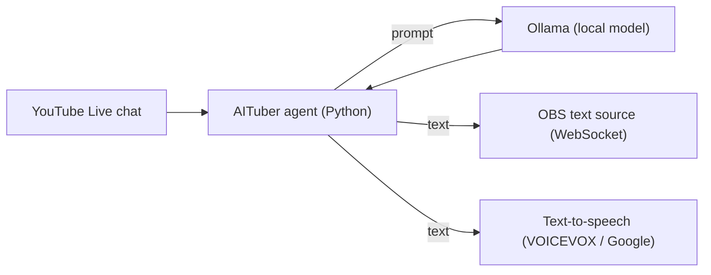
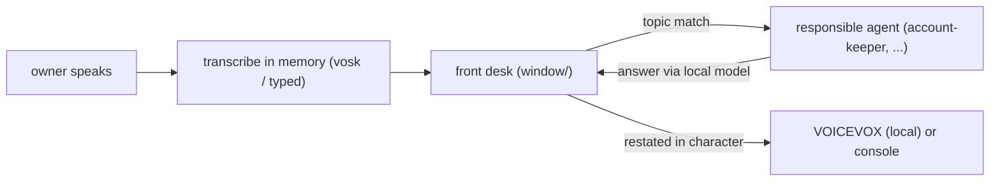

# AITuber Agent

> Hobby project; working name.

**One line:** an AI co-host for live streams: it reads YouTube Live chat, writes a reply with a local language model, shows it on screen through OBS, and speaks it with a voice synthesizer.

## What it does
- Reads comments from a YouTube Live chat.
- Generates a reply with a model served by [Ollama](https://ollama.com) on the streamer's own machine, so viewers' comments are not sent to a cloud AI service.
- Sends the reply to a text source in OBS (through OBS WebSocket) and reads it aloud with a text-to-speech engine (VOICEVOX or Google Cloud Text-to-Speech).
- An offline demo runs the same comment-to-reply-to-display path with fixed comments and no external services.
- The same parts also serve as a persona front desk: talk to a character, it passes the question to the agent that
  owns the topic and answers out loud (see `Persona front desk` below).

## How it is built


## Persona front desk (`window/`)

The same parts (local model, display, speech) also work as a **door to an agent**: a person talks to a character
and the character hands the question to the agent that owns the topic, then says the answer back.



```
pip install -r requirements.txt       # requests for the desk, pytest to run the suite
pip install -r requirements-mic.txt   # optional: numpy, sounddevice, vosk for --mic / real VOICEVOX playback
python3 run_window.py --demo          # scripted walk-through, stub model, no hardware needed
python3 run_window.py --text          # type instead of speaking, local model at 127.0.0.1:8123/v1
python3 run_window.py --mic           # speak; needs requirements-mic.txt (AITUBER_VOSK_MODEL=<dir>),
                                      # and ends by itself after three turns with no speech
python3 run_window.py --tts voicevox --tts-url http://127.0.0.1:50021
python3 -m window personas            # same face for the dashboard's list of agents (JSON on stdout)
```

`requests` is the only package the desk itself needs at runtime (`pytest` is listed in `requirements.txt` only to
run the tests). `window.asr` and `window.tts` import numpy, sounddevice and vosk
lazily, so a missing optional dependency only affects the mode that actually needs it: the offline demo,
the tests, `--text`, `--once` and `--tts print` still run, and a feature that would need a local HTTP call
says what is missing instead of crashing (`--tts voicevox` falls back to printed text).

One persona so far, `personas/account-keeper.json`: name, look, avatar, voice (`speaker_id`), speech style, what the
agent is responsible for (`handles`) and, later, a loopback `agent_endpoint`. Add a file to add a character. An
`agent_endpoint` must answer with a JSON object like `{"reply": "..."}`; a non-object body, broken JSON or an
unreachable URL gets an explicit "no answer" line and nothing is sent anywhere else.

Configuration by environment: `AITUBER_LLM_URL` (default `http://127.0.0.1:8123/v1`), `AITUBER_LLM_MODEL`,
`AITUBER_TTS_URL` (default `http://127.0.0.1:50021`), `AITUBER_VOSK_MODEL`. Anything non-loopback is refused, and
nothing here listens on a port. The desk also refuses to point at a port another service already owns on these
machines (DeepSeek on 8080, ollama on 11434, and the other in-use ports), so the default cannot silently query a
real service instead of the intended local model. A refused or unusable model URL is reported as a plain error line,
and it never stops the offline demo, which never talks to a model at all. Digit runs of twelve or more digits (of any
length, not only card-length, and including hyphen- or space-separated groups like `4111-1111-1111-1111`) and
labelled secret values (password, PIN, CVV, 暗証番号…) are stripped from the words
before they reach the local model, an agent endpoint or any reply — including when Japanese runs the label straight
into a particle (`暗証番号は…`) or English links them with a verb (`my password is …`).

What the door will not do:
- Recording is captured into memory and dropped; no audio file and no transcript file is written.
- Anything that buys, pays, sends, deletes or cancels is handed back as a plan that needs the owner's own yes/no;
  the character has no hands on the accounts and does not nudge the owner towards a decision.
- It says it is a machine when asked, never speaks to a third party in the owner's name, and ignores instructions
  that arrived from outside (an email, a caller, "someone told me to").
- The local model is the only brain in the loop; `--stub-llm` exists only for tests and the demo.
- A recogniser that hands back broken output (not JSON, or JSON that is not an object) is treated as "nothing heard",
  so one bad recogniser result cannot end the session.

## Status
| Verified | How |
|---|---|
| Comment to reply to display path | offline demo (`demo.py`) ran on 2026-10-12 with fixed comments |
| Spoken question to agent to spoken answer | `run_window.py --demo` and `--text` against the local model, 2026-10-31 |
| No recording or transcript file left on disk (any extension, any name, any subdirectory, temp dir included) | `tests/test_window_flow.py::test_no_recording_file_is_left_on_disk` |
| "Cancel this card" always asks first | `tests/test_window_flow.py`, English and Japanese |
| A dangerous request the persona does not cover still asks | `tests/test_window_flow.py::test_a_dangerous_request_outside_the_persona_still_asks_for_confirmation` |
| `--mic` ends instead of spinning when nothing is said | `tests/test_window_flow.py::test_the_mic_loop_ends_after_repeated_silence` |
| Runs where `requests` is not installed | `requirements.txt`, and the suite re-run with the package made unimportable |
| Runs where the optional mic / playback extras are not installed | `requirements-mic.txt` stays absent; the suite re-runs with numpy and sounddevice made unimportable |
| Loopback `agent_endpoint` answers, and bad bodies are handled | fake loopback endpoint in `tests/test_window_flow.py` |
| An instruction injected into an agent reply is not acted on | `tests/test_window_flow.py::test_an_instruction_injected_into_the_agent_reply_is_not_acted_on` |
| Card numbers and passwords are redacted before the model and the agent | `tests/test_window_flow.py`, and a `--once` dry-run on 2026-11-01 |
| Redaction also catches a label run into a Japanese particle, a verb-linked English label, and digit runs longer than 19 | `tests/test_window_flow.py::test_a_secret_label_that_runs_into_a_japanese_particle_is_redacted`, `::test_a_secret_linked_by_an_english_verb_is_redacted`, `::test_an_account_number_longer_than_a_card_number_is_redacted` |
| The prompt the local model is shown carries no secret value | `tests/test_window_flow.py::test_a_secret_never_reaches_the_prompt_sent_to_the_local_model` |
| An unreachable loopback endpoint answers that it has no answer | `tests/test_window_flow.py::test_an_unreachable_loopback_endpoint_leaves_the_desk_with_no_answer` |
| A broken microphone is a usable error line whether or not numpy is installed | `tests/test_window_flow.py::test_a_broken_microphone_is_reported_as_a_usable_error`, with numpy stubbed so it holds either way |
| An unusable model URL is a plain error line, and the demo does not depend on one | `tests/test_window_flow.py::test_an_unusable_local_model_url_is_reported_instead_of_crashing`, `::test_the_offline_demo_ignores_a_local_model_url_that_would_be_refused` |
| A recogniser result that is not usable JSON ends the turn as silence | `tests/test_window_flow.py::test_a_vosk_recognizer_that_hands_back_broken_output_yields_no_text` |
| The default model URL cannot reach DeepSeek or ollama ports | `tests/test_local_only.py`, in-use ports (8080, 11434, ...) are refused |
| A persona `agent_endpoint` on an in-use loopback port is refused before any request is attempted | `tests/test_local_only.py::test_an_agent_endpoint_on_a_clash_loopback_port_is_refused` |
| A hyphen-separated card number is redacted like a spaced one | `tests/test_window_flow.py::test_a_hyphenated_card_number_never_reaches_the_agent_endpoint` |
| Any primary voice-engine failure (not just connection errors) falls back to printed text | `tests/test_window_flow.py::test_fallback_tts_survives_a_non_runtime_failure_in_the_primary_engine` |
| `--once` waits for the owner's yes/no before finishing | `tests/test_window_flow.py`, and a `--once` dry-run on 2026-11-01 |
| Mic capture is capped so it cannot run unbounded | `tests/test_window_flow.py::test_a_long_capture_is_capped_and_writes_nothing_to_disk` |
| Not verified | |
| A real YouTube Live stream, OBS and TTS together | needs an API key, a live stream and OBS; not run end to end |
| Reply quality and moderation | not evaluated |
| Real microphone speech | needs numpy, sounddevice and a vosk model; capture is capped at 15s and unit-tested with a fake vosk, but real capture was not run here |
| A real agent process behind `agent_endpoint` | only a fake loopback endpoint was exercised; the reply is redacted and screened before display |
| Playing real VOICEVOX audio | needs a running VOICEVOX plus numpy and sounddevice; unit-tested with a fake audio device, the fallback to printed text is what ran here |

Assumption: the private implementation lives in this repo under `window/` plus `personas/` and `run_window.py`; the
agent implementations themselves are elsewhere and are reached through a loopback `agent_endpoint` when present.

## Where it could go
The most useful role is probably not a fully AI streamer but an **AI partner for human VTubers**: a co-host that keeps up with chat, answers regulars and fills quiet moments, while the human stays the star. As models improve, the partner gets better without the streamer changing anything.

*Source is private and can be shared on request. A hobby project of [Happy AI Garage](https://github.com/johnknash2025).*
