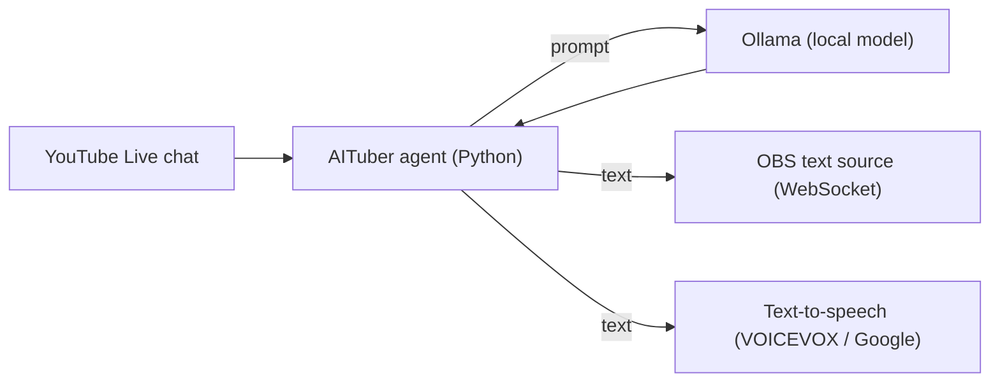

# AITuber Agent

> Hobby project; working name.

**One line:** an AI co-host for live streams: it reads YouTube Live chat, writes a reply with a local language model, shows it on screen through OBS, and speaks it with a voice synthesizer.

## What it does
- Reads comments from a YouTube Live chat.
- Generates a reply with a model served by [Ollama](https://ollama.com) on the streamer's own machine, so viewers' comments are not sent to a cloud AI service.
- Sends the reply to a text source in OBS (through OBS WebSocket) and reads it aloud with a text-to-speech engine (VOICEVOX or Google Cloud Text-to-Speech).
- An offline demo runs the same comment-to-reply-to-display path with fixed comments and no external services.

## How it is built

## Status
| Verified | How |
|---|---|
| Comment to reply to display path | offline demo (`demo.py`) ran on 2026-10-12 with fixed comments |
| Not verified | |
| A real YouTube Live stream, OBS and TTS together | needs an API key, a live stream and OBS; not run end to end |
| Reply quality and moderation | not evaluated |

## Where it could go
The most useful role is probably not a fully AI streamer but an **AI partner for human VTubers**: a co-host that keeps up with chat, answers regulars and fills quiet moments, while the human stays the star. As models improve, the partner gets better without the streamer changing anything.

*Source is private and can be shared on request. A hobby project of [Happy AI Garage](https://github.com/johnknash2025).*
